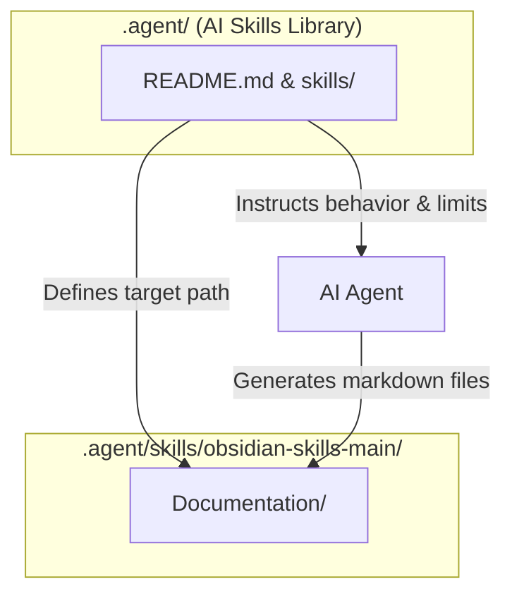

# 🔄 Skills Library & Obsidian Integration

| Directory | Type | Role |
| :--- | :--- | :--- |
| `.agent/` | Configuration & Behavior | AI Skills Library (Agent instruction set) |
| `.agent/skills/obsidian-skills-main/` | Output & Knowledge Vault | Obsidian vault for human-readable documentation |

---

## 🗺️ Integration Architecture

This diagram illustrates how the AI Agent leverages local configurations and outputs to your Obsidian vault without conflicts:

---

## 🔒 Coexistence & Safety (No Conflicts)

There is no conflict between these directories because their roles are clearly separated:

> [!note] Separation of Concerns
> * **Control Plane (`.agent/`)**: Modifies agent behaviors, settings, and skills instructions (e.g. `agent-tool-builder`, `data-analyst`).
> * **Data Plane (`.agent/skills/obsidian-skills-main/`)**: Acts as a storage location for markdown files produced for human consumption.
> 
> Because they reside in distinct paths and serve separate stages of the execution cycle, they will never overwrite each other's content.

### Alignment Flow
1. You request documentation or write a prompt.
2. The AI reads `.agent/README.md` to load default or scenario-specific skills.
3. The AI generates the requested files and saves them to `.agent/skills/obsidian-skills-main/Documentation/`.
4. Your Obsidian vault displays the new notes, updated graphs, and wiki-links instantly.

---

## 📚 Related Documentation
- [[AI_Skills_Library_Configuration]] — Detailed configuration of the library and the default Tool Builder skill.
- [[Project_Readme]] — Overview of the main project structure.
- [[Home]] — Knowledge Base Dashboard.
