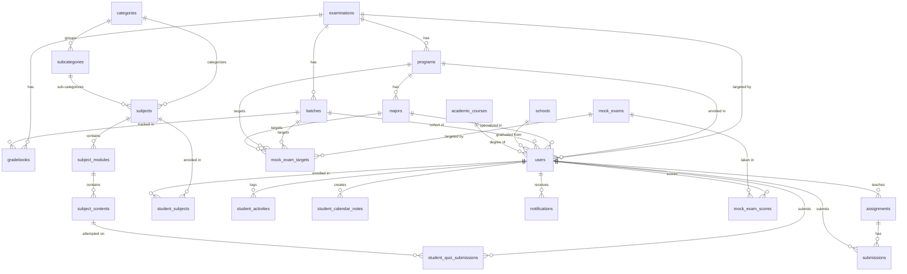

# PostgreSQL Database Schema & Data Dictionary

## Overview
This document serves as the complete technical specification and data dictionary for the **ReviewApp** PostgreSQL database (`reviewapp`).

- **Database Engine**: PostgreSQL 14+
- **Total Tables**: 25 Normalized Tables (0 Duplicates)
- **Normalization Level**: 3NF (Third Normal Form) with relational integrity, foreign key cascades, and optimized indexes.

---

## Entity-Relationship Diagram (ERD)

---

## 1. Academic & Institutional Master Data

### `examinations`
Master catalog of board and professional licensure examinations (e.g., LEPT, NCLEX).
| Column | Type | Nullable | Default | Description |
|---|---|---|---|---|
| `id` | `INTEGER` (PK) | NO | `nextval()` | Unique identifier |
| `name` | `VARCHAR(255)` | NO | — | Unique exam name (e.g., "LEPT") |
| `created_at` | `TIMESTAMPTZ` | NO | `NOW()` | Timestamp created |
| `updated_at` | `TIMESTAMPTZ` | NO | `NOW()` | Timestamp last updated |

### `programs`
Educational programs affiliated with an examination.
| Column | Type | Nullable | Default | Description |
|---|---|---|---|---|
| `id` | `INTEGER` (PK) | NO | `nextval()` | Unique identifier |
| `exam_id` | `INTEGER` (FK) | NO | — | `REFERENCES examinations(id) ON DELETE CASCADE` |
| `name` | `VARCHAR(255)` | NO | — | Program code/name (e.g., "BSEd", "BEEd") |
| `created_at` | `TIMESTAMPTZ` | NO | `NOW()` | Timestamp created |

### `majors`
Specialization fields under specific programs.
| Column | Type | Nullable | Default | Description |
|---|---|---|---|---|
| `id` | `INTEGER` (PK) | NO | `nextval()` | Unique identifier |
| `program_id` | `INTEGER` (FK) | NO | — | `REFERENCES programs(id) ON DELETE CASCADE` |
| `name` | `VARCHAR(255)` | NO | — | Major specialization (e.g., "English", "Mathematics") |
| `created_at` | `TIMESTAMPTZ` | NO | `NOW()` | Timestamp created |

### `batches`
Review cohorts/batches organized per examination and target year.
| Column | Type | Nullable | Default | Description |
|---|---|---|---|---|
| `id` | `INTEGER` (PK) | NO | `nextval()` | Unique identifier |
| `name` | `VARCHAR(255)` | NO | — | Batch name (e.g., "Batch 1") |
| `exam_id` | `INTEGER` (FK) | NO | — | `REFERENCES examinations(id) ON DELETE CASCADE` |
| `target_year`| `INTEGER` | NO | — | Target exam year (e.g., 2026) |
| `status` | `VARCHAR(50)` | NO | `'upcoming'` | Status: `'active'`, `'upcoming'`, `'completed'` |
| `created_at` | `TIMESTAMPTZ` | NO | `NOW()` | Timestamp created |
| `updated_at` | `TIMESTAMPTZ` | NO | `NOW()` | Timestamp last updated |

### `schools`
Master directory of educational institutions and universities.
| Column | Type | Nullable | Default | Description |
|---|---|---|---|---|
| `id` | `INTEGER` (PK) | NO | `nextval()` | Unique identifier |
| `name` | `VARCHAR(255)` | NO | — | Unique university / school name |
| `address` | `TEXT` | YES | — | School address location |
| `created_at` | `TIMESTAMPTZ` | NO | `NOW()` | Timestamp created |
| `updated_at` | `TIMESTAMPTZ` | NO | `NOW()` | Timestamp last updated |

### `academic_courses`
Master catalog of higher education degree programs.
| Column | Type | Nullable | Default | Description |
|---|---|---|---|---|
| `id` | `INTEGER` (PK) | NO | `nextval()` | Unique identifier |
| `name` | `VARCHAR(255)` | NO | — | Unique academic degree title |
| `created_at` | `TIMESTAMPTZ` | NO | `NOW()` | Timestamp created |
| `updated_at` | `TIMESTAMPTZ` | NO | `NOW()` | Timestamp last updated |

---

## 2. User Management & Authentication

### `users`
Unified accounts table for Admins, Teachers, and Students.
| Column | Type | Nullable | Default | Description |
|---|---|---|---|---|
| `id` | `INTEGER` (PK) | NO | `nextval()` | Unique user identifier |
| `name` | `VARCHAR(100)` | NO | — | Full display name |
| `email` | `VARCHAR(255)` | NO | — | Unique login email |
| `password` | `VARCHAR(255)` | NO | — | Bcrypt-hashed password |
| `role` | `VARCHAR(20)` | NO | `'student'` | Role: `'student'`, `'teacher'`, `'admin'` |
| `first_name` | `VARCHAR(100)` | YES | — | First name |
| `middle_name`| `VARCHAR(100)` | YES | — | Middle name |
| `last_name` | `VARCHAR(100)` | YES | — | Last name |
| `suffix` | `VARCHAR(20)` | YES | — | Name suffix (e.g., Jr., III) |
| `birthday` | `DATE` | YES | — | Birth date |
| `gender` | `VARCHAR(30)` | YES | — | Gender |
| `phone` | `VARCHAR(30)` | YES | — | Contact telephone/mobile |
| `address` | `VARCHAR(255)` | YES | — | Street address |
| `city` | `VARCHAR(100)` | YES | — | City / Municipality |
| `province` | `VARCHAR(100)` | YES | — | Province / Region |
| `zip_code` | `VARCHAR(20)` | YES | — | Postal zip code |
| `school` | `VARCHAR(255)` | YES | — | Denormalized school name for query speed |
| `course` | `VARCHAR(255)` | YES | — | Denormalized degree course name |
| `year_graduated` | `VARCHAR(10)` | YES | — | Graduation year |
| `highest_education` | `VARCHAR(50)` | YES | — | Educational attainment |
| `avatar` | `TEXT` | YES | — | Custom avatar image data / URL |
| `avatar_url` | `TEXT` | YES | — | Profile avatar URL |
| `batch_id` | `INTEGER` (FK) | YES | — | `REFERENCES batches(id) ON DELETE SET NULL` |
| `exam_id` | `INTEGER` (FK) | YES | — | `REFERENCES examinations(id) ON DELETE SET NULL` |
| `program_id` | `INTEGER` (FK) | YES | — | `REFERENCES programs(id) ON DELETE SET NULL` |
| `major_id` | `INTEGER` (FK) | YES | — | `REFERENCES majors(id) ON DELETE SET NULL` |
| `school_id` | `INTEGER` (FK) | YES | — | `REFERENCES schools(id) ON DELETE SET NULL` |
| `academic_course_id` | `INTEGER` (FK) | YES | — | `REFERENCES academic_courses(id) ON DELETE SET NULL` |
| `job_role_description`| `TEXT` | YES | — | Professional profile bio |
| `lept_major_id` | `INTEGER` | YES | — | Major classification identifier |
| `examinee_status` | `VARCHAR(50)` | YES | — | First-time taker / Retaker |
| `diagnostic_score` | `INTEGER` | YES | — | Baseline assessment score |
| `personal_target_score` | `INTEGER` | YES | — | Target exam score goal |
| `font_preference` | `VARCHAR(50)` | YES | `'geist'` | UI font preference |
| `created_at` | `TIMESTAMPTZ` | NO | `NOW()` | Registration timestamp |
| `last_login_at` | `TIMESTAMPTZ` | YES | — | Last authenticated timestamp |
| `login_count` | `INTEGER` | YES | `0` | Cumulative login counter |
| `targets` | `JSONB` | YES | `'[]'::jsonb`| Target tags & eligibility strings |

---

## 3. Curriculum & LMS Hierarchy

### `categories`
Top-level subject groupings (e.g., General Education, Professional Education, Specialization).
| Column | Type | Nullable | Default | Description |
|---|---|---|---|---|
| `id` | `INTEGER` (PK) | NO | `nextval()` | Unique category identifier |
| `name` | `VARCHAR(255)` | NO | — | Unique category name |
| `description` | `TEXT` | YES | — | Category description |
| `has_subcategories` | `BOOLEAN` | NO | `TRUE` | `true` if divided into subcategories |
| `target_course` | `VARCHAR(255)` | YES | `'all'` | Target examination / course constraint |
| `target_program`| `VARCHAR(255)` | YES | `'all'` | Target program constraint |
| `target_major` | `VARCHAR(255)` | YES | `'all'` | Target major constraint |
| `created_at` | `TIMESTAMPTZ` | NO | `NOW()` | Timestamp created |
| `updated_at` | `TIMESTAMPTZ` | NO | `NOW()` | Timestamp last updated |

### `subcategories`
Mid-level subject groupings under categories (e.g., English, Filipino, Math under General Education).
| Column | Type | Nullable | Default | Description |
|---|---|---|---|---|
| `id` | `INTEGER` (PK) | NO | `nextval()` | Unique subcategory identifier |
| `category_id` | `INTEGER` (FK) | NO | — | `REFERENCES categories(id) ON DELETE CASCADE` |
| `name` | `VARCHAR(255)` | NO | — | Subcategory name |
| `description` | `TEXT` | YES | — | Subcategory description |
| `image_url` | `TEXT` | YES | — | Cover thumbnail URL |
| `status` | `VARCHAR(20)` | NO | `'active'` | Status: `'active'`, `'inactive'` |
| `created_at` | `TIMESTAMPTZ` | NO | `NOW()` | Timestamp created |
| `updated_at` | `TIMESTAMPTZ` | NO | `NOW()` | Timestamp last updated |

### `subjects`
Individual courses/subjects linked to categories and subcategories.
| Column | Type | Nullable | Default | Description |
|---|---|---|---|---|
| `id` | `INTEGER` (PK) | NO | `nextval()` | Unique subject identifier |
| `title` | `VARCHAR(255)` | NO | — | Subject title |
| `code` | `VARCHAR(50)` | NO | — | Unique course code (e.g., "COMM-102") |
| `description` | `TEXT` | YES | — | Subject description |
| `image_url` | `TEXT` | YES | — | Subject banner image URL |
| `category` | `VARCHAR(100)` | YES | — | Denormalized category name |
| `category_id` | `INTEGER` (FK) | YES | — | `REFERENCES categories(id) ON DELETE CASCADE` |
| `subcategory_id`| `INTEGER` (FK)| YES | — | `REFERENCES subcategories(id) ON DELETE CASCADE` |
| `status` | `VARCHAR(20)` | NO | `'active'` | Status: `'active'`, `'inactive'` |
| `unlock_date` | `TIMESTAMPTZ` | YES | — | Timed unlock date for students |
| `topics` | `JSONB` | NO | `'[]'::jsonb`| Array of topic tags |
| `created_at` | `TIMESTAMPTZ` | NO | `NOW()` | Timestamp created |
| `updated_at` | `TIMESTAMPTZ` | NO | `NOW()` | Timestamp last updated |

### `subject_modules`
Curriculum modules / chapters inside a subject.
| Column | Type | Nullable | Default | Description |
|---|---|---|---|---|
| `id` | `INTEGER` (PK) | NO | `nextval()` | Unique module identifier |
| `subject_id` | `INTEGER` (FK) | YES | — | `REFERENCES subjects(id) ON DELETE CASCADE` |
| `title` | `VARCHAR(255)` | NO | — | Module title (e.g., "Chapter 1: Study Skills") |
| `order_index` | `INTEGER` | YES | `0` | Display sort order |
| `created_at` | `TIMESTAMPTZ` | NO | `NOW()` | Timestamp created |

### `subject_contents`
Individual lessons, PDFs, and interactive quizzes inside a module.
| Column | Type | Nullable | Default | Description |
|---|---|---|---|---|
| `id` | `INTEGER` (PK) | NO | `nextval()` | Unique lesson/content identifier |
| `module_id` | `INTEGER` (FK) | YES | — | `REFERENCES subject_modules(id) ON DELETE CASCADE` |
| `subject_code` | `VARCHAR(50)` | YES | — | Subject code reference |
| `title` | `VARCHAR(255)` | NO | — | Lesson/Quiz title |
| `lesson_type` | `VARCHAR(50)` | YES | `'module'` | Type: `'module'` (canvas), `'pdf'`, `'quiz'` |
| `contentbuilder_id`| `VARCHAR(100)`| YES | — | Builder payload reference |
| `pdf_files` | `JSONB` | YES | `'[]'::jsonb`| Array of attached PDF documents |
| `quiz_content` | `TEXT` | YES | — | Rich JSON string containing quiz questions |
| `order_index` | `INTEGER` | YES | `0` | Display sort order |
| `created_at` | `TIMESTAMPTZ` | NO | `NOW()` | Timestamp created |
| `updated_at` | `TIMESTAMPTZ` | NO | `NOW()` | Timestamp last updated |

### `student_subjects`
Direct subject enrollments for individual students.
| Column | Type | Nullable | Default | Description |
|---|---|---|---|---|
| `id` | `INTEGER` (PK) | NO | `nextval()` | Unique enrollment record identifier |
| `student_id` | `INTEGER` (FK) | NO | — | `REFERENCES users(id) ON DELETE CASCADE` |
| `subject_id` | `INTEGER` (FK) | NO | — | `REFERENCES subjects(id) ON DELETE CASCADE` |
| `assigned_at` | `TIMESTAMPTZ` | NO | `NOW()` | Timestamp enrolled |

---

## 4. Assessments, Mock Exams & Gradebooks

### `mock_exams`
Full-length mock board examination definitions.
| Column | Type | Nullable | Default | Description |
|---|---|---|---|---|
| `id` | `INTEGER` (PK) | NO | `nextval()` | Unique mock exam identifier |
| `exam_code` | `VARCHAR(50)` | NO | — | Unique mock exam code (e.g., "MOCK-101") |
| `title` | `VARCHAR(255)` | NO | — | Mock exam title |
| `description` | `TEXT` | YES | — | Exam instructions and description |
| `questions` | `JSONB` | NO | `'[]'::jsonb`| JSON array of questions, options, & answers |
| `targets` | `JSONB` | NO | `'[]'::jsonb`| Targeted cohorts string tags |
| `unlock_date` | `TIMESTAMPTZ` | YES | — | Scheduled date when exam unlocks |
| `status` | `VARCHAR(20)` | NO | `'locked'` | Status: `'active'`, `'locked'` |
| `created_by` | `INTEGER` (FK) | YES | — | `REFERENCES users(id) ON DELETE SET NULL` |
| `created_at` | `TIMESTAMPTZ` | NO | `NOW()` | Timestamp created |
| `updated_at` | `TIMESTAMPTZ` | NO | `NOW()` | Timestamp last updated |

### `mock_exam_targets`
Relational mapping linking mock exams to batches, programs, and majors.
| Column | Type | Nullable | Default | Description |
|---|---|---|---|---|
| `id` | `INTEGER` (PK) | NO | `nextval()` | Unique target mapping identifier |
| `mock_exam_id` | `INTEGER` (FK) | NO | — | `REFERENCES mock_exams(id) ON DELETE CASCADE` |
| `batch_id` | `INTEGER` (FK) | YES | — | `REFERENCES batches(id) ON DELETE CASCADE` |
| `program_id` | `INTEGER` (FK) | YES | — | `REFERENCES programs(id) ON DELETE CASCADE` |
| `major_id` | `INTEGER` (FK) | YES | — | `REFERENCES majors(id) ON DELETE CASCADE` |

### `mock_exam_scores`
Individual student mock exam attempt scores and response sheets.
| Column | Type | Nullable | Default | Description |
|---|---|---|---|---|
| `id` | `INTEGER` (PK) | NO | `nextval()` | Unique score record identifier |
| `student_id` | `INTEGER` (FK) | NO | — | `REFERENCES users(id) ON DELETE CASCADE` |
| `mock_exam_id` | `INTEGER` (FK) | NO | — | `REFERENCES mock_exams(id) ON DELETE CASCADE` |
| `score` | `INTEGER` | NO | `0` | Student's earned score |
| `max_score` | `INTEGER` | NO | `0` | Total maximum attainable score |
| `student_answers`| `JSONB` | YES | `'{}'::jsonb`| Student's submitted answers |
| `completed_at` | `TIMESTAMPTZ` | YES | `NOW()` | Timestamp exam was submitted |

### `student_quiz_submissions`
Student quiz submission attempts on module lessons.
| Column | Type | Nullable | Default | Description |
|---|---|---|---|---|
| `id` | `INTEGER` (PK) | NO | `nextval()` | Unique submission identifier |
| `student_id` | `INTEGER` (FK) | NO | — | `REFERENCES users(id) ON DELETE CASCADE` |
| `content_id` | `INTEGER` (FK) | NO | — | `REFERENCES subject_contents(id) ON DELETE CASCADE` |
| `earned_points` | `INTEGER` | NO | `0` | Earned points |
| `total_points` | `INTEGER` | NO | `0` | Total quiz points |
| `time_taken_seconds`| `INTEGER` | NO | `0` | Duration taken to finish quiz |
| `answers` | `JSONB` | NO | `'[]'::jsonb`| Detailed answers breakdown |
| `attempts_count`| `INTEGER` | NO | `1` | Number of attempt retries |
| `submitted_at` | `TIMESTAMPTZ` | NO | `NOW()` | Submission timestamp |

### `gradebooks`
Aggregated gradebook records per batch and exam.
| Column | Type | Nullable | Default | Description |
|---|---|---|---|---|
| `id` | `INTEGER` (PK) | NO | `nextval()` | Unique gradebook identifier |
| `name` | `VARCHAR(255)` | NO | — | Gradebook title |
| `code` | `VARCHAR(100)` | NO | — | Unique gradebook code |
| `batch_id` | `INTEGER` (FK) | NO | — | `REFERENCES batches(id) ON DELETE CASCADE` |
| `exam_id` | `INTEGER` (FK) | NO | — | `REFERENCES examinations(id) ON DELETE CASCADE` |
| `status` | `VARCHAR(50)` | YES | `'ACTIVE'` | Status: `'ACTIVE'`, `'ARCHIVED'` |
| `targets` | `JSONB` | YES | `'[]'::jsonb`| Target audience parameters |
| `created_at` | `TIMESTAMPTZ` | YES | `NOW()` | Timestamp created |
| `updated_at` | `TIMESTAMPTZ` | YES | `NOW()` | Timestamp last updated |

---

## 5. Assignments & Teacher Submissions

### `assignments`
Assignments posted by teachers.
| Column | Type | Nullable | Default | Description |
|---|---|---|---|---|
| `id` | `INTEGER` (PK) | NO | `nextval()` | Unique assignment identifier |
| `title` | `VARCHAR(255)` | NO | — | Assignment title |
| `description` | `TEXT` | YES | — | Assignment instructions |
| `teacher_id` | `INTEGER` (FK) | NO | — | `REFERENCES users(id) ON DELETE CASCADE` |
| `created_at` | `TIMESTAMPTZ` | NO | `NOW()` | Timestamp created |

### `submissions`
Student submissions to teacher assignments.
| Column | Type | Nullable | Default | Description |
|---|---|---|---|---|
| `id` | `INTEGER` (PK) | NO | `nextval()` | Unique submission identifier |
| `assignment_id`| `INTEGER` (FK) | NO | — | `REFERENCES assignments(id) ON DELETE CASCADE` |
| `student_id` | `INTEGER` (FK) | NO | — | `REFERENCES users(id) ON DELETE CASCADE` |
| `content` | `TEXT` | YES | — | Student submission text/payload |
| `status` | `VARCHAR(20)` | NO | `'pending'` | Status: `'pending'`, `'reviewed'` |
| `grade` | `VARCHAR(10)` | YES | — | Teacher assigned grade |
| `feedback` | `TEXT` | YES | — | Teacher review feedback |
| `submitted_at` | `TIMESTAMPTZ` | NO | `NOW()` | Submission timestamp |
| `reviewed_at` | `TIMESTAMPTZ` | YES | — | Reviewed timestamp |

---

## 6. Student Engagement & Notifications

### `student_activities`
Activity logs tracking student progress and module completions.
| Column | Type | Nullable | Default | Description |
|---|---|---|---|---|
| `id` | `INTEGER` (PK) | NO | `nextval()` | Unique activity log identifier |
| `student_id` | `INTEGER` (FK) | NO | — | `REFERENCES users(id) ON DELETE CASCADE` |
| `activity_type`| `VARCHAR(100)`| NO | — | Type: `'module_complete'`, `'quiz_complete'` |
| `title` | `VARCHAR(255)` | NO | — | Activity headline |
| `details` | `TEXT` | YES | — | Additional activity notes |
| `status` | `VARCHAR(50)` | YES | `'completed'`| Status indicator |
| `created_at` | `TIMESTAMPTZ` | NO | `NOW()` | Timestamp logged |

### `student_calendar_notes`
Personal calendar notes and study events created by students.
| Column | Type | Nullable | Default | Description |
|---|---|---|---|---|
| `id` | `INTEGER` (PK) | NO | `nextval()` | Unique calendar note identifier |
| `student_id` | `INTEGER` (FK) | NO | — | `REFERENCES users(id) ON DELETE CASCADE` |
| `event_date` | `DATE` | NO | — | Date of event / reminder |
| `title` | `VARCHAR(255)` | NO | — | Event title |
| `description` | `TEXT` | YES | — | Event notes |
| `time` | `VARCHAR(50)` | YES | — | Event scheduled time |
| `tag` | `VARCHAR(50)` | YES | — | Category tag |
| `created_at` | `TIMESTAMPTZ` | NO | `NOW()` | Timestamp created |
| `updated_at` | `TIMESTAMPTZ` | NO | `NOW()` | Timestamp last updated |

### `notifications`
System and in-app notifications for students.
| Column | Type | Nullable | Default | Description |
|---|---|---|---|---|
| `id` | `INTEGER` (PK) | NO | `nextval()` | Unique notification identifier |
| `student_id` | `INTEGER` (FK) | YES | — | `REFERENCES users(id) ON DELETE CASCADE` (or `NULL` for global broadcasts) |
| `type` | `VARCHAR(50)` | NO | — | Type: `'quiz'`, `'mock_exam'`, `'system'` |
| `title` | `VARCHAR(255)` | NO | — | Notification title |
| `message` | `TEXT` | NO | — | Body message content |
| `link` | `VARCHAR(255)` | YES | — | Target URL navigation link |
| `is_read` | `BOOLEAN` | YES | `FALSE` | Read status |
| `created_at` | `TIMESTAMPTZ` | YES | `NOW()` | Timestamp generated |

---

## 7. Media & System Assets

### `carousel_slides`
Landing page promotional and informational hero carousel slides.
| Column | Type | Nullable | Default | Description |
|---|---|---|---|---|
| `id` | `INTEGER` (PK) | NO | `nextval()` | Unique slide identifier |
| `src` | `TEXT` | NO | — | Banner image source path |
| `alt` | `VARCHAR(255)` | YES | — | Accessibility alt text |
| `badge` | `VARCHAR(255)` | YES | `'New Course Available'` | Slide header badge |
| `title` | `VARCHAR(255)` | YES | — | Slide headline title |
| `description` | `TEXT` | YES | — | Slide descriptive subtitle |
| `slide_order` | `INTEGER` | NO | `0` | Carousel index order |
| `created_at` | `TIMESTAMPTZ` | NO | `NOW()` | Timestamp created |
| `updated_at` | `TIMESTAMPTZ` | NO | `NOW()` | Timestamp last updated |

### `uploaded_files`
Binary database storage for uploaded attachments and media.
| Column | Type | Nullable | Default | Description |
|---|---|---|---|---|
| `id` | `INTEGER` (PK) | NO | `nextval()` | Unique file identifier |
| `filename` | `TEXT` | NO | — | Original file name |
| `content_type` | `TEXT` | YES | — | MIME type (e.g., `image/png`, `application/pdf`) |
| `size` | `BIGINT` | NO | `0` | File size in bytes |
| `data` | `BYTEA` | NO | — | Binary raw data |
| `created_at` | `TIMESTAMPTZ` | NO | `NOW()` | Upload timestamp |

---

## Performance & Foreign Key Index Catalog

All foreign key and frequently filtered columns are indexed:

| Table | Index Name | Indexed Column(s) | Purpose |
|---|---|---|---|
| `users` | `idx_users_email` | `email` (UNIQUE) | Fast authentication lookup |
| `users` | `idx_users_school_id` | `school_id` | Fast school relation lookups |
| `users` | `idx_users_academic_course_id`| `academic_course_id`| Fast degree relation lookups |
| `users` | `idx_users_exam_id` | `exam_id` | Fast exam filtering |
| `users` | `idx_users_program_id` | `program_id` | Fast program filtering |
| `users` | `idx_users_major_id` | `major_id` | Fast major filtering |
| `users` | `idx_users_batch_id` | `batch_id` | Fast batch filtering |
| `programs` | `idx_programs_exam` | `exam_id` | Exam to programs lookups |
| `majors` | `idx_majors_program` | `program_id` | Program to majors lookups |
| `batches` | `idx_batches_exam` | `exam_id` | Exam to batches lookups |
| `subcategories`| `idx_subcategories_category` | `category_id` | Category to subcategories lookups |
| `subjects` | `idx_subjects_code` | `code` (UNIQUE) | Fast subject code lookups |
| `subjects` | `idx_subjects_category_id` | `category_id` | Direct category to subject joins |
| `subjects` | `idx_subjects_subcategory_id` | `subcategory_id` | Subcategory to subject joins |
| `subject_modules`| `idx_subject_modules_subject`| `subject_id` | Subject to module hierarchy |
| `subject_contents`| `idx_subject_contents_module`| `module_id` | Module to lesson hierarchy |
| `student_subjects`| `idx_student_subjects_student`| `student_id` | Student enrollments |
| `mock_exams` | `idx_mock_exams_code` | `exam_code` (UNIQUE)| Fast mock exam code lookups |
| `mock_exam_targets`| `idx_mock_exam_targets_exam` | `mock_exam_id` | Target resolution |
| `mock_exam_scores` | `idx_mock_exam_scores_student`| `student_id` | Student score sheets |
| `mock_exam_scores` | `idx_mock_exam_scores_exam` | `mock_exam_id` | Exam score distribution |
| `gradebooks` | `idx_gradebooks_batch_id` | `batch_id` | Batch gradebooks |
| `gradebooks` | `idx_gradebooks_exam_id` | `exam_id` | Exam gradebooks |
| `assignments`| `idx_assignments_teacher` | `teacher_id` | Teacher assignment list |
| `submissions`| `idx_submissions_student` | `student_id` | Student submission list |
| `submissions`| `idx_submissions_assignment`| `assignment_id` | Assignment submissions |
| `submissions`| `idx_submissions_status` | `status` | Submission review status |
| `student_activities`| `idx_student_activities_student`| `student_id` | Student activity timeline |
| `student_calendar_notes`| `idx_student_calendar_notes_student`| `student_id` | Student calendar |
| `student_calendar_notes`| `idx_student_calendar_notes_date` | `event_date` | Date range filtering |
| `student_quiz_submissions`| `idx_student_quiz_submissions_student`| `student_id` | Student quiz attempts |
| `student_quiz_submissions`| `idx_student_quiz_submissions_content`| `content_id` | Content quiz stats |
| `notifications`| `idx_notifications_student` | `student_id` | Student notification feed |
