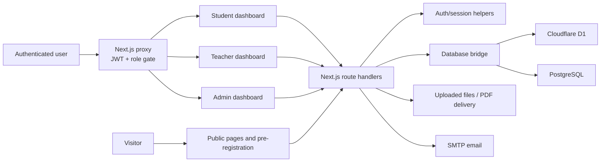

# Reviewer Exam - RE — Project Analysis

**Status:** codebase review completed 8 November 2026  
**Scope:** application source, configuration, database schemas, and existing repository documentation. This is an architectural summary, not a production security audit.

## Executive summary

Reviewer Exam - RE is Owl Review Center's full-stack web platform for examination review programs worldwide. It provides a public marketing and pre-registration flow, then separate learning and administration experiences for students, instructors, and administrative staff. The application is built with Next.js App Router and React, deployed as a Cloudflare Worker through OpenNext, and can use either Cloudflare D1 (SQLite) or PostgreSQL through one shared database interface.

The product is substantially broader than a quiz application. Its core domain includes user onboarding, role and permission management, curriculum authoring and delivery, subject materials and PDF viewing, quizzes and mock exams, assignments, student activity/progress, calendars, notifications, subscription/batch controls, analytics, and a soft-delete trash area.

## At a glance

| Area | Implementation |
|---|---|
| Web framework | Next.js 16.1.6, React 19, App Router |
| Styling and UI | Tailwind CSS 4, Base UI, shadcn-style components, Motion, Recharts |
| Deployment | Cloudflare Workers using OpenNext and Wrangler |
| Data stores | Cloudflare D1 in Workers; PostgreSQL fallback for local Node.js and scripts |
| Authentication | `jose`-signed JWT in an HTTP-only session cookie; bcrypt password hashing |
| Primary user roles | Student, Teacher, Admin, Super Admin, Academic Admin, Registrar, plus custom administrative roles |
| Core routes | Public landing/pre-registration, `/student`, `/teacher`, `/admin` |

## Architecture

### Key layers

- **User interface:** `src/app` contains route pages, layouts, and loading states. Shared and feature components live in `src/components`.
- **API:** `src/app/api` contains 100+ method handlers for public, authentication, user, student, teacher, admin, file, and security capabilities.
- **Access control:** `src/proxy.js` verifies the session JWT and routes users to role-appropriate dashboards. It also applies rate limiting to login and password-recovery requests.
- **Business helpers:** `src/lib` centralizes authentication, database access, rate limiting, roles, login-ID generation, storage, file/trash handling, email, curriculum, and student metrics helpers.
- **Persistence:** `src/lib/db.js` exposes a pg-like `db.query()` API. It selects D1 in the Worker runtime and PostgreSQL when a local connection is configured. The SQL adapter translates common PostgreSQL syntax for D1.

## User experiences

### Public and applicant flow

- Marketing landing page with program information, subscription content, and calls to action.
- Pre-registration submission via `/pre-register` and `/api/public/pre-register`.
- Administrators review and approve pre-registrations, creating an actual student account.

### Student flow

- Dashboard with activity, charts, study heartbeat, countdowns, notifications, calendar, assignments, subjects, profile, preferences, and security reporting.
- Curriculum navigation from category to subject, module, and lesson; material support includes file/PDF viewing.
- Learning evidence is recorded through quiz submissions, subject progress, activities, study sessions, daily statistics, mock-exam scores, and assignment submissions.

### Teacher flow

- Teacher home and profile.
- Subject/module/lesson management under `/teacher/modules` and companion APIs.
- Category and subject delivery endpoints shared with the curriculum data model.

### Administration flow

- User lifecycle management, profiles, role assignment, sequential Login ID previews, and pre-registration approval.
- Master data management for exams, programs, majors, batches, schools, courses, categories, subcategories, and subjects.
- Curriculum authoring; mock exams; gradebooks; notifications; carousel/banner content; search; analytics; security settings/sessions; subscription monitoring; and trash recovery.
- Batch subscription controls can restrict expired student access, reassign students to a batch, and apply individual extensions.

## Identity, authorization, and security controls

1. A successful login creates a JWT with a seven-day expiry and stores it in an HTTP-only, same-site cookie.
2. `src/proxy.js` verifies the token before protected page requests and restricts `/student`, `/teacher`, and `/admin` routes by role. Any non-student/non-teacher custom role is treated as administrative for `/admin` access.
3. The login endpoint accepts both the permanent Login ID and legacy email address. Login IDs are generated from a sanitized surname plus a zero-padded sequence.
4. Login and password-recovery requests are rate-limited by IP and account identifier. The repository also includes security settings, incident reporting, security audit logs, and active-session data models.

## Data model

`setup.sql` is the PostgreSQL schema; `d1_setup.sql` is the D1/SQLite counterpart. Both model the same major product areas:

- **Identity and administration:** users, custom roles, password reset tokens, security settings/logs, active sessions, pre-registrations, notifications, and trash items.
- **Institutional metadata:** examinations, programs, majors, batches, schools, and academic courses.
- **Curriculum:** categories, subcategories, subjects, subject modules, subject contents, student-subject enrollment, and uploaded files.
- **Assessment and learning:** mock exams, targeting, scores, gradebooks, quiz submissions, subject progress, assignments, and submissions.
- **Engagement and reporting:** activities, study sessions, daily student statistics, calendar notes, daily registration statistics, and carousel slides.

The schemas define 37 tables in the D1 version. Foreign keys and indexes support the central user, curriculum, assessment, and cohort relationships. The existing detailed data dictionary is [DATABASE_SCHEMA.md](../Document/DATABASE_SCHEMA.md).

## Runtime and deployment

- **Local UI development:** `npm run dev` (Next.js on port 3000).
- **Database bootstrap:** `npm run db:setup`, using `.env.local`.
- **Worker-compatible preview:** `npm run preview` (OpenNext build plus Wrangler development server).
- **Deployment:** `npm run deploy` (OpenNext build plus Wrangler deploy).
- **Cloudflare configuration:** `wrangler.jsonc` binds D1 as `DB`, enables observability, and defines the `reviewerexam.com` and `www.reviewerexam.com` custom domains.

Required local configuration is documented in `.env.example`: a database connection and a strong `JWT_SECRET`; SMTP settings are optional. See [DOMAINS_AND_ENV_GUIDE.md](DOMAINS_AND_ENV_GUIDE.md) for the operating guide.

## Repository map

| Path | Purpose |
|---|---|
| `src/app` | App Router pages, route groups, layouts, and API handlers |
| `src/components` | Shared UI and feature-specific React components |
| `src/lib` | Database, auth, authorization, email, uploads, rate limiting, and domain helpers |
| `public` | Images, Lottie animations, icons, and landing-page assets |
| `scripts` | Database setup/wipe and pre-registration maintenance utilities |
| `setup.sql` / `d1_setup.sql` | PostgreSQL and D1 schema/seed scripts |
| `Document` and `docs` | Product, database, PDF, IP, and operating documentation |
| `wrangler.jsonc` / `open-next.config.ts` | Cloudflare Worker/OpenNext deployment configuration |

## Strengths

- Clear separation of public, student, teacher, and admin experiences.
- A pragmatic database abstraction supports fast local PostgreSQL work and Cloudflare D1 deployment from largely the same application code.
- The data model covers the full learning lifecycle rather than only content storage.
- Auth protection is centralized in a proxy, with cookie flags, JWT expiry, rate limiting, and session/security concepts present in the design.
- Existing operational and schema documentation gives future contributors a useful starting point.

## Findings and recommended next steps

These are implementation observations, not confirmed vulnerabilities.

1. **Require the JWT secret in deployed environments.** `src/lib/auth.js` provides a development fallback secret. Production startup/deploy validation should fail when `JWT_SECRET` is missing, so an insecure fallback can never sign live sessions.
2. **Change or remove seeded credentials outside local development.** The setup documentation and scripts expose known `password123` seed accounts. They are convenient for local initialization but should not exist in an internet-facing database.
3. **Complete curriculum ordering persistence.** The curriculum content layout contains a TODO for persisting an item's reordered parent/position. This means drag/reorder behavior may not survive a refresh.
4. **Verify both database modes in CI.** PostgreSQL-to-D1 translation is intentionally limited; a small integration suite for critical authentication, user, curriculum, and assessment queries in both runtimes would reduce deployment risk.
5. **Keep branding aligned.** Historical records may refer to PEAK, ReviewApp, or CSE Review System. Use Reviewer Exam - RE for the product and Owl Review Center for the organization in new content.
6. **Add automated quality gates.** The package has ESLint but no visible test script. Add unit tests for helpers and route-level integration tests for permission and subscription rules before major releases.

## Related documentation

- [README.md](../README.md) — setup and deployment overview
- [SYSTEM_FEATURES.md](../Document/SYSTEM_FEATURES.md) — documented feature workflows
- [DATABASE_SCHEMA.md](../Document/DATABASE_SCHEMA.md) — data dictionary and ERD
- [PDF_Viewer_Strategy_And_Tuning.md](../Document/PDF_Viewer_Strategy_And_Tuning.md) — PDF handling guidance
- [USER_GUIDE.md](USER_GUIDE.md) — user-facing operating guide
